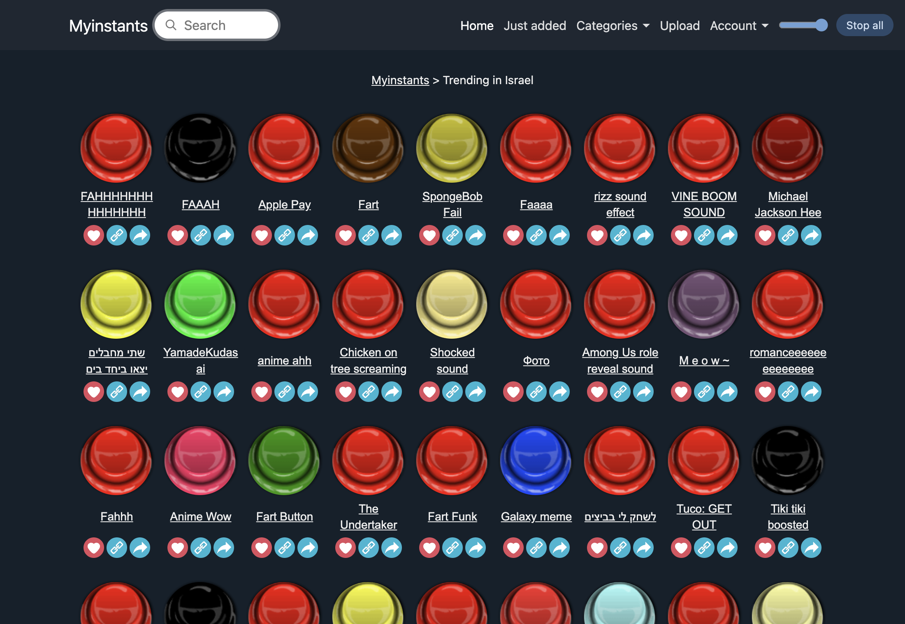
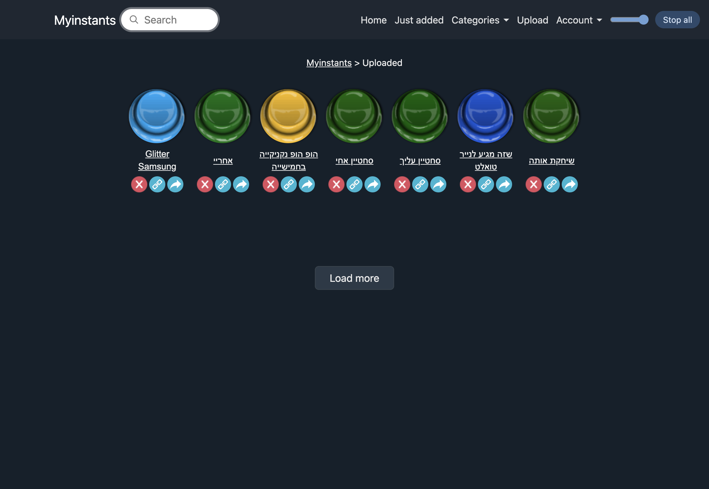
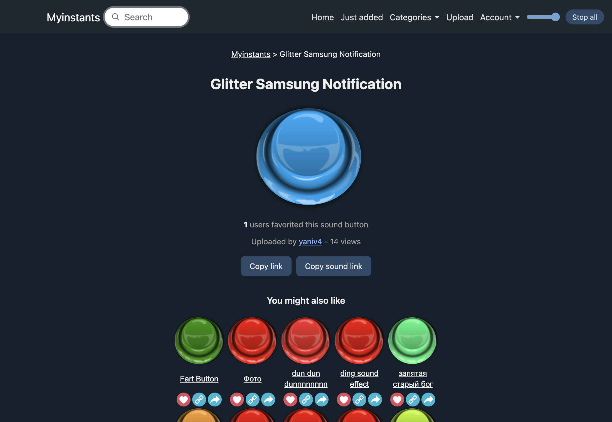
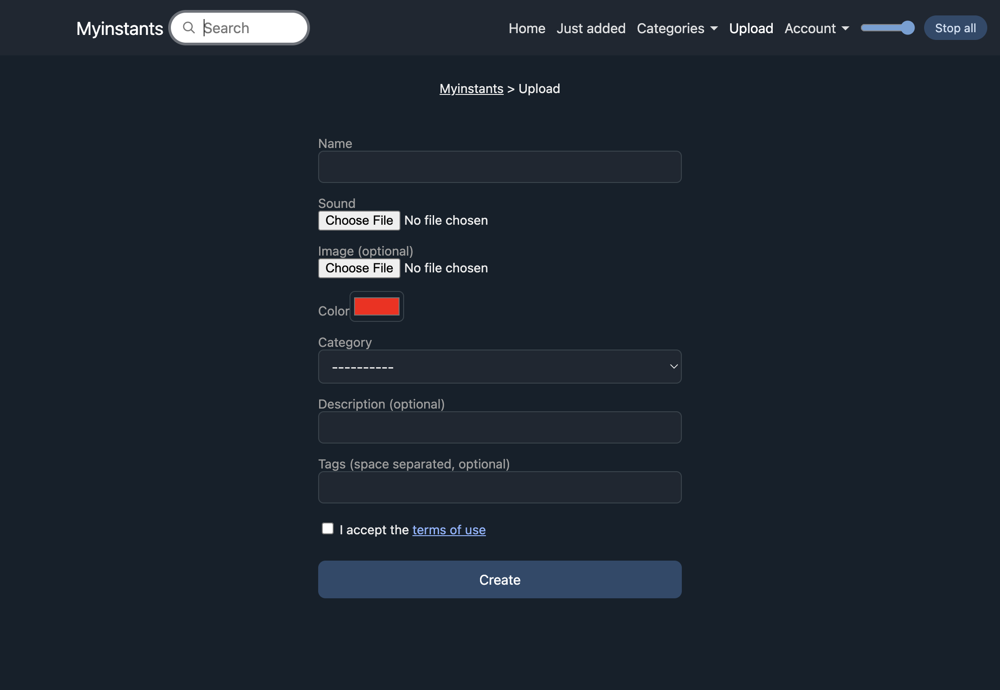
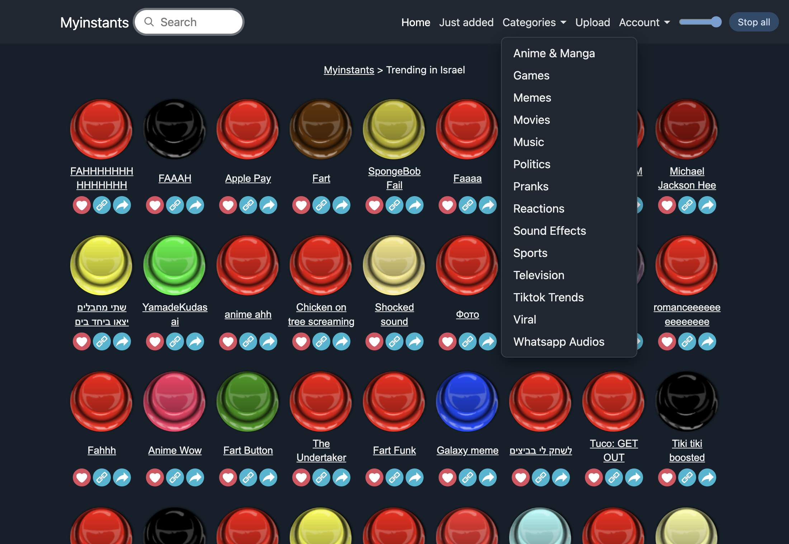
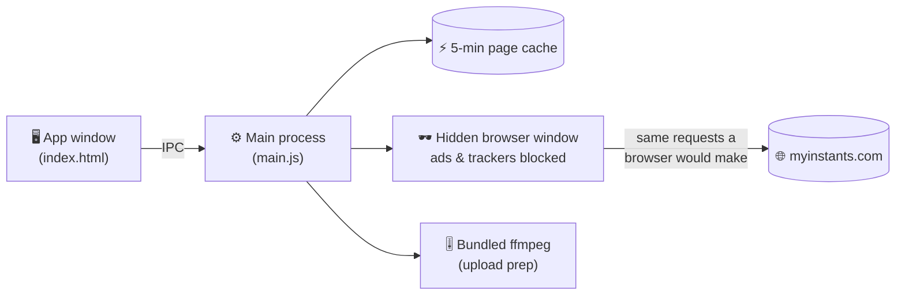

<div align="center">


# MyInstants for macOS

**The entire [myinstants.com](https://www.myinstants.com) soundboard as a fast, ad‑free desktop app.**
Browse, play, favorite, upload and delete instant sound buttons — no browser tab, no ads, no pop‑ups.

[](#-installation)
[](#-installation)
[](https://www.electronjs.org/)
[](../../releases/latest)

[**⬇️ Download**](../../releases/latest) · [Features](#-features) · [Install](#-installation) · [How it works](#-how-it-works) · [FAQ](#-faq--troubleshooting)

<br>



</div>

---

## ✨ Features

| | |
|---|---|
| 🔥 **Trending, Just added & 14 categories** | Everything the site has, laid out as the familiar glossy buttons. |
| 🔎 **Search** | Find any sound across the whole library. |
| ▶️ **One‑click playback** | Click to play, one sound at a time, with a volume slider and a **Stop all** button. |
| ❤️ **Real account favorites** | Favorites sync with your myinstants.com account — not a local bookmark list. |
| ⬆️ **Upload** | Name, color, category, tags — and the app **prepares the file for you** (see below). |
| ❌ **Delete your own sounds** | Same red ✕ and confirmation as the site, from your Uploaded page. |
| 🚫 **No ads, no trackers** | The app only talks to myinstants.com. ~100 ad/tracker requests per page are never made. |
| ⚡ **Fast** | Pages you've visited in the last 5 minutes open instantly from memory. |
| 📦 **Self‑contained** | ffmpeg is bundled — nothing else to install. |

### 🎚️ Smart uploads

myinstants.com is picky about files. The app fixes them before they're sent, so you don't have to:

- 🖼️ **Strips embedded cover art & tags** — the cause of *"File type is not supported"* on MP3s downloaded from YouTube.
- 🗜️ **Shrinks files over the 300 KB limit**, stepping the bitrate down only as far as needed.
- 🔄 **Converts WAV, M4A and other formats** to MP3.
- 💬 **Shows the site's real error** (e.g. *"Instant with this Name already exists"*) instead of a generic failure.

Your original file is never touched.

## 📸 Screenshots

<table>
  <tr>
    <td width="50%"><p align="center"><b>Your uploads</b> — delete with the red ✕</p></td>
    <td width="50%"><p align="center"><b>Sound page</b> — stats, uploader, related sounds</p></td>
  </tr>
  <tr>
    <td width="50%"><p align="center"><b>Upload</b> — files prepared automatically</p></td>
    <td width="50%"><p align="center"><b>Categories</b> — all 14 of them</p></td>
  </tr>
</table>

## 📥 Installation

> **Requirements:** a Mac with Apple Silicon (M1 or newer) running macOS 11 Big Sur or later.

1. **Download** `MyInstants-macOS-arm64.zip` from the [latest release](../../releases/latest).
2. **Unzip** it and drag **MyInstants.app** into your **Applications** folder.
3. **First launch:** the app isn't notarized by Apple, so macOS will block a normal double‑click the first time.
   **Right‑click** the app → **Open** → **Open**. You only need to do this once.

<details>
<summary>😕 Still says the app is "damaged" or "can't be opened"?</summary>
<br>

That's macOS quarantining a downloaded, unsigned app. Clear the flag once from Terminal:

```bash
xattr -dr com.apple.quarantine /Applications/MyInstants.app
```

Then open it normally.
</details>

4. **Sign in:** click **Login** (top right) and sign in to your myinstants.com account inside the app.
   Browsing and playing work without an account; favorites, uploading and deleting need one.

> [!NOTE]
> Your sign‑in is stored on that Mac only (in `~/Library/Application Support/MyInstants`). On a new computer, just sign in again.

## 🧭 Using it

| Want to… | Do this |
|---|---|
| Play a sound | Click its button. Click another to switch, or **Stop all**. |
| Open a sound's page | Click its name. |
| See more by the same uploader | Right‑click a button. |
| Favorite / unfavorite | Click the ❤️ (needs sign‑in). |
| Upload | **Upload** in the top bar → fill the form → **Create**. You land on your Uploaded page. |
| Delete one of your sounds | **Account → Uploaded** → red ✕ → confirm. |
| Copy a link | 🔗 copies the sound's page, ↗️ copies the MP3 file link. |

## 🔧 How it works

myinstants.com has no public app API and sits behind Cloudflare's bot protection, which blocks plain HTTP requests. So the app does what a browser does — in a window you never see:



- **Reading pages:** the hidden window loads the real page, passes Cloudflare's automatic check like any browser, and the app reads the sound list as soon as the HTML is parsed — it doesn't wait for ads.
- **Account actions** (favorite, upload, delete) run *inside* that page, so they're the exact requests the site's own buttons send, with your normal session.
- **The cache** is cleared after anything you change, so lists never show a state from before your change.
- **If Cloudflare ever wants an interactive check**, a small *Verifying…* window appears — tick the box once and the app carries on.

The app doesn't bypass or automate the bot check, and it doesn't pretend to be a different browser.

## 🛠️ Build from source

Needs **Node.js 18–25** (Node 22 LTS recommended). On Node 26 the packager stops silently while unpacking Electron and no app is written.

```bash
git clone https://github.com/yanivbahalul/Myinstants-MacOS.git
cd Myinstants-MacOS
npm install-scripts approve electron ffmpeg-static   # newer npm only: lets them download their binaries
npm install          # Electron, the packager and a static ffmpeg build
npm start            # run in development
npm run build        # → MyInstants-darwin-arm64/MyInstants.app
npm run zip          # → MyInstants-macOS-arm64.zip for a release
```

<details>
<summary>📁 Project layout</summary>
<br>

| File | What it does |
|---|---|
| `main.js` | Main process: hidden window, Cloudflare handling, page cache, ad blocking, favorite / upload / delete, upload file prep. |
| `index.html` | The whole UI — layout, styles and logic in one file. |
| `parse.js` | Turns myinstants.com HTML into sound lists. |
| `preload.js` | The safe bridge between the UI and the main process. |
| `bin/ffmpeg` | Added at build time from [`ffmpeg-static`](https://github.com/eugeneware/ffmpeg-static); not checked in. |

</details>

## ❓ FAQ & troubleshooting

<details>
<summary><b>"Couldn't reach myinstants.com" or a "Verifying…" window</b></summary>
<br>
Cloudflare occasionally asks for a check. If a small window appears, complete it once; the app reuses the result. If a page fails, wait a minute and try again — hammering refresh makes Cloudflare stricter.
</details>

<details>
<summary><b>"sound is too long to fit under 300KB — trim it first"</b></summary>
<br>
The site caps sounds at 300 KB. The app compresses down to a low bitrate, but clips longer than roughly a minute and a half can't fit. Trim the clip and upload again.
</details>

<details>
<summary><b>"Instant with this Name already exists"</b></summary>
<br>
Names are unique across the whole site. Pick a different name.
</details>

<details>
<summary><b>I deleted a sound but still see it on the website</b></summary>
<br>
The site says deletions can take up to a day to clear from its cache. The app hides it from your list right away.
</details>

<details>
<summary><b>Does it work on Intel Macs?</b></summary>
<br>
The release build is Apple Silicon only. Building from source with <code>--arch=x64</code> should work but isn't tested.
</details>

## 🔒 Privacy

- The app only connects to **myinstants.com** (and Cloudflare's check when the site asks for it). No analytics, no telemetry, no third‑party servers.
- Your session stays in the app's own data folder on your Mac.
- `debug.log` in that folder records one status line per account action (never page contents) to help diagnose problems.

## ⚖️ Disclaimer

This is an **unofficial**, community‑made client. It is not affiliated with, endorsed by, or connected to Myinstants. All sounds belong to their respective uploaders; please follow the site's [terms of use](https://www.myinstants.com/en/terms_of_use.html) when uploading.

The bundled ffmpeg is distributed under its own license — see `bin/ffmpeg.LICENSE` inside the app.

<div align="center">
<br>

Made with ❤️ on a Mac · If it saves you a browser tab, leave a ⭐

</div>
